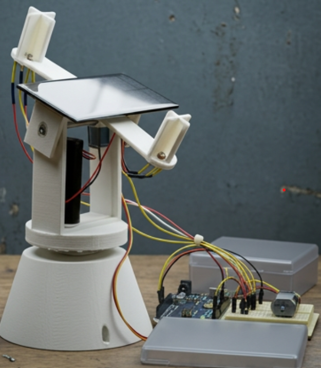
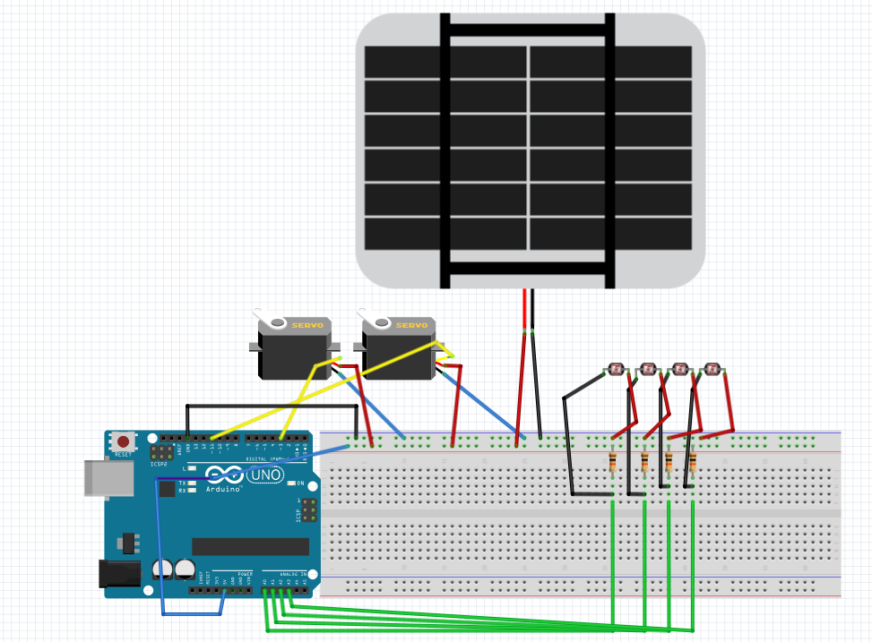
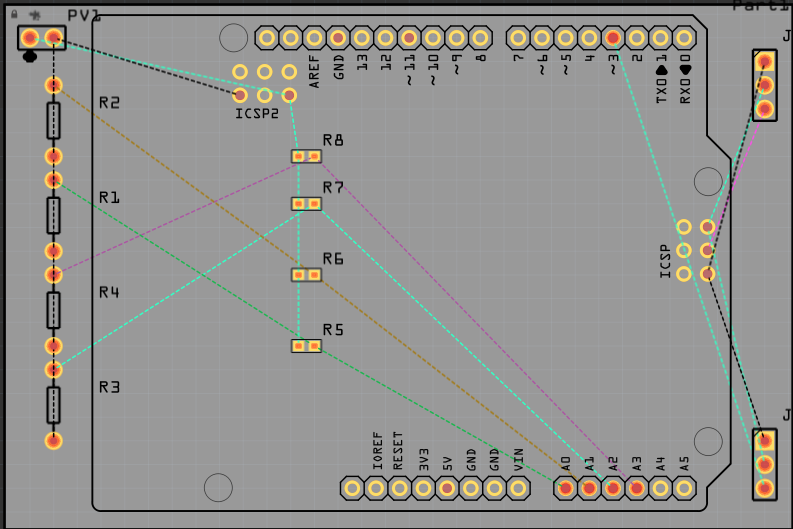
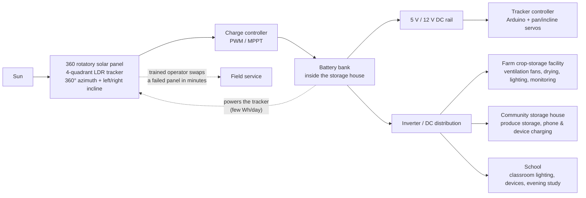
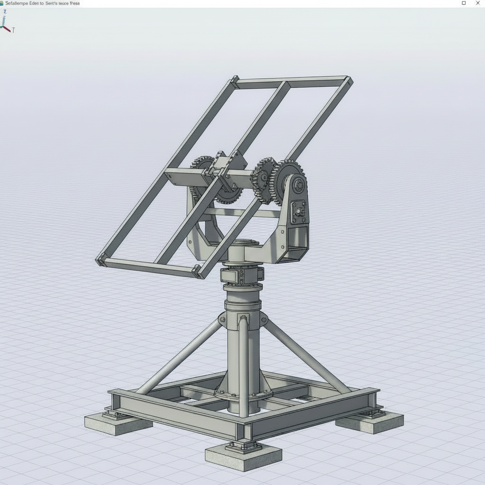

# 360 Rotatory Solar-Panel Detector for Sunlight

[](https://github.com/Gift-Sato-Kuepouo/360_Rotatory_Solar-Panel_Detector-for-sunlight/actions/workflows/ci.yml)
[](LICENSE)
[](tests/test_tracking_logic.c)
[](tests/test_tracker_sim.py)
[](firmware/solar_tracker/solar_tracker.ino)

A dual-axis, **360° rotatable solar panel** that finds the sun by itself and stores the energy it harvests built as an affordable, field-serviceable power source for **dense-forest communities in Cameroon** whose villages receive unreliable, low-voltage electricity. The panel rotates a full 360° around its mast and **inclines left and right**, so it follows the sun from east to west all day and keeps crop-storage facilities, storage houses and schools running on stored solar energy.



*The demo I built to test the full process an improved version of the tracker from the [inspiration video](https://www.youtube.com/watch?v=zXX4d5eyvb8&t=152s), designed to be closer to the final vision picture that my research says low-income communities in Cameroon could actually deploy on the ground.*


## Table of contents

- [Why this exists](#why-this-exists)
- [What was built](#what-was-built)
- [Key features](#key-features)
- [System architecture](#system-architecture)
- [Hardware design](#hardware-design)
- [Mechanical design (SolidWorks)](#mechanical-design-solidworks)
- [Reference design for future ground implementation](#reference-design-for-future-ground-implementation)
- [Coding section - make it fully functional](#coding-section---make-it-fully-functional)
- [Testing - what GitHub proves on every push](#testing---what-github-proves-on-every-push)
- [Deployment: farms, storage houses and schools](#deployment-farms-storage-houses-and-schools)
- [Research: is this sustainable for low-income Cameroon?](#research-is-this-sustainable-for-low-income-cameroon)
- [Field serviceability: the panel-swap workflow](#field-serviceability-the-panel-swap-workflow)
- [Related project: AgriStorage-Room](#related-project-agristorage-room)
- [Repository structure](#repository-structure)
- [Roadmap](#roadmap)
- [Acknowledgements](#acknowledgements)
- [License](#license)


## Why this exists

In rural Cameroon, **75% of people still live without electricity** (World Bank, 2025), and the
grid that does reach underserved villages often arrives low and unreliable — not enough to run
anything. Meanwhile, **up to 40% of certain crops are lost after harvest** (FAO) mainly because
storage facilities have no dependable power for drying, ventilation, lighting and monitoring.

This project is one concrete answer:

1. **Harvest more energy per panel.** A tracking panel produces roughly **+20–32% more energy**
   than a fixed panel of the same size (peer-reviewed dual-axis studies, see
   [research](#research-is-this-sustainable-for-low-income-cameroon)). On a small, affordable
   array, that margin is the difference between a storage facility that runs and one that does not.
2. **Store it beside the load.** The panel feeds a charge controller and a battery bank housed in
   a **storage house built beside the facility** — so energy is available after sunset for
   overnight crop-storage operations.
3. **Survive the local market.** Solar panels sold locally are often low quality and fail early.
   The mechanical and electrical interface is designed so that **a trained person can swap a
   damaged panel in minutes** without replacing the tracker, the wiring or the storage system —
   and without going back to an expensive specialist.

## What was built

A working breadboard-and-PCB demo of the full tracking process, plus CAD for the mechanics:

| Stage | Artefact |
|---|---|
| Sensing + actuation prototype (breadboard) |  |
| Dedicated PCB for the tracker electronics |  |
| Point-of-interest view of the demo |  |
| Source design (Fritzing) | [`hardware/360_degree_solar_panel_detector.fzz`](hardware/360_degree_solar_panel_detector.fzz) |
| Mechanical CAD | SolidWorks (turntable, gimbal brackets, panel frame — see [mechanical design](#mechanical-design-solidworks)) |

- **Breadboard prototype** — the first complete wiring of the four-quadrant LDR sensor, the two
  drive servos and the controller, used to validate the process end to end.
- **PCB design** — the same circuit consolidated onto a two-layer board so the tracker can be
  assembled more than once, more reliably, by trained local technicians.
- **Demo unit** — the improved, complete build shown in the photo above: an iteration on the
  tracker from the [inspiration video](https://www.youtube.com/watch?v=zXX4d5eyvb8&t=152s)
  ("How to make solar tracker using arduino | Dual axis solar tracker using arduino"), reworked
  toward the vision design for on-ground use in Cameroon.
- **Point-of-interest view** — a closer look at the demo/implementation from the key point of
  interest (sensor/drive arrangement).

## Key features

- **Continuous 360° azimuth rotation** — the panel follows the sun east → south → west across the
  whole day; the firmware wraps the azimuth at 360° so it never hits an end stop.
- **Bidirectional incline (tilt) axis** — the panel **inclines left and right** past horizontal
  (mechanical window −10°…100°, configurable), which matters near the equator where the sun swings
  north and south of the zenith.
- **Four-quadrant LDR sun detection** — 4 photocells + 4× 10 kΩ dividers compute a horizontal and
  a vertical light error; coarse/fine steps converge on the brightest direction.
- **Deadband hysteresis (diffuse-light hold)** — under overcast sky or forest shade, where LDR
  contrast is flat, the tracker holds position instead of hunting and wasting power.
- **Night parking** — below the night threshold the panel parks east at a slight incline (5°) so
  rain runs off and it is already facing the sunrise; it resumes automatically at dawn.
- **Stall latch protection** — if the drives are commanded but the light picture stops responding
  (blocked mechanism, flat static light) the tracker stops moving and blinks its status LED
  instead of stripping gears.
- **Panel-swap friendly** — after a trained operator exchanges a failed panel, one serial command
  (`c`) clears the stall latch and tracking resumes with the existing calibration.
- **Day-tested in simulation** — the exact C logic that runs on the Arduino is simulated over a
  synthetic equatorial day: **+29.7% energy vs a fixed panel, 99.2% of perfect sun-tracking**
  (see [testing](#testing---what-github-proves-on-every-push)).

## System architecture

Energy is harvested by the tracker, conditioned by a charge controller and **stored inside a
storage house built beside the load** — a farm crop-storage facility, a community storage house,
or a school:



The tracker itself only consumes a few Wh per day (it moves only when the error leaves the
deadband), so the energy it adds (+20–32%) is a clear net gain for the storage system.

## Hardware design

The Fritzing source of record is
[`hardware/360_degree_solar_panel_detector.fzz`](hardware/360_degree_solar_panel_detector.fzz)
(open it with [Fritzing](https://fritzing.org)). The integrity test suite re-parses this file on
every push to confirm the design still matches the bill of materials below.

### Bill of materials (from the Fritzing design)

| Ref | Qty | Part | Role |
|---|---|---|---|
| R1–R4 | 4 | LDR photocell | Quadrant sun sensing (top-left, top-right, bottom-left, bottom-right) |
| R5–R8 | 4 | Resistor, **10 kΩ**, 5%, 400 mil | Voltage dividers from the LDRs into the ADC |
| PV1 | 1 | Solar panel, 6 V (demo) | Harvest — scales to 100–200 W modular panels in the field unit |
| J1 | 1 | Servo motor | **Azimuth drive** — rotates the turntable |
| J2 | 1 | Servo motor | **Incline drive** — leans the panel left/right |
| — | 1 | Arduino Uno/Nano | Runs the tracking logic (not in the fzz; shown on the breadboard) |
| BB1 | 1 | Full-size breadboard | Prototype wiring |
| PCB1 | 1 | Two-layer PCB | Repeatable production build of the tracker electronics |
| — | 1 | PWM/MPPT charge controller + battery | Energy storage for the facility (field unit) |
| — | 1 | Slip ring (field unit) | Continuous 360° azimuth without twisting the cables |

### Wiring (demo, matches the breadboard photo)

| Signal | Arduino pin | Notes |
|---|---|---|
| LDR top-left (R1) | A0 | 10 kΩ divider to 5 V / GND |
| LDR top-right (R2) | A1 | 10 kΩ divider |
| LDR bottom-left (R3) | A2 | 10 kΩ divider |
| LDR bottom-right (R4) | A3 | 10 kΩ divider |
| Pan servo (J1) | D9 (PWM) | Servo powered from a separate 5 V rail — **not** from the Arduino 5 V pin |
| Incline servo (J2) | D10 (PWM) | Same external 5 V rail |
| Status LED | D13 (built-in) | Solid = tracking, off = night park, blinking = stall latch |
| Serial monitor | USB / 115200 baud | Telemetry + service commands |

> Power note: servos must share **ground** with the Arduino but be fed from their own supply.
> In the field unit, the 6 V panel + charge controller + battery + buck converter replace the USB
> supply entirely, and a slip ring keeps the azimuth truly continuous.

## Mechanical design (SolidWorks)

The demo's mechanical assembly was modeled in **SolidWorks** before fabrication:

- **Turntable + mast clamp** — carries the panel through a full 360° azimuth rotation.
- **Incline gimbal brackets** — the pivot that lets the panel **lean left and right**, sized for
  the −10°…100° window the firmware allows.
- **Panel frame with quick-release mounting** — the interface that makes the panel itself the
  swappable item: four fasteners, one connector, no re-calibration of the tracker body.
- **Servo horns / linkage** — converts servo travel to the logical 0–359° azimuth and the
  incline angle used in software.

CAD-first iteration means part dimensions can be checked for interference and 3D-printed or
locally machined before anything is cut — important where ordering replacements is slow and
expensive.

## Reference design for future ground implementation

The photo below is the **reference design** this repository commits to for the next stage: an
on-ground build in dense-forest, low-income communities in Cameroon. It is an improved version
of the tracker from the [inspiration video](https://www.youtube.com/watch?v=zXX4d5eyvb8&t=152s),
configured as closely as possible to the field vision.



*The vision implementation — the reference design for a future ground unit.*

What the reference design locks in for the ground build:

| Aspect | Reference choice | Why |
|---|---|---|
| Sensing | Four-quadrant LDR (A0–A3, 10 kΩ dividers) | Cheap, locally available, no calibration tooling needed |
| Azimuth | Continuous 360° (turntable + slip ring in field unit) | Full east→south→west sun path; no end stops |
| Incline | Bidirectional −10°…100° (left/right) | Equatorial sun swings north and south of the zenith |
| Controller | Arduino Uno/Nano + portable C99 core in this repo | Reproducible, CI-tested, one-command flash |
| Panel | Modular, quick-release, field-swappable | Local low-quality panels fail early; swap in minutes |
| Storage | Battery + controller in a storage house beside the load | Energy usable exactly where crop storage / school needs it |
| Mechanics | SolidWorks turntable, gimbal brackets, panel frame | 3D-print or machine locally; parts checked for interference |

The firmware, simulation, BOM and wiring in this repository are the software/hardware baseline
that the ground implementation should build on — not a separate redesign.

## Coding section - make it fully functional

Everything needed to run the tracker is in this repository:


firmware/
├── solar_tracker/solar_tracker.ino          # the sketch you upload
└── libraries/tracking_logic/                # portable C99 tracking core
    ├── tracking_logic.h
    ├── tracking_logic.c
    └── library.properties
software/tracker_sim.py                      # same logic, closed-loop day simulation
```

### 1. Upload the firmware (Arduino IDE or arduino-cli)

**Arduino IDE**

1. Open `firmware/solar_tracker/solar_tracker.ino`.
2. Copy `firmware/libraries/tracking_logic` into your Arduino libraries folder
   (Sketch → Include Library → Add .ZIP Library, or drop the folder into `Arduino/libraries/`).
3. Select **Arduino Uno** (or Nano), set the board/port, and press **Upload**.

**arduino-cli (what CI runs):**

```bash
arduino-cli core install arduino:avr
arduino-cli compile \
  --fqbn arduino:avr:uno \
  --library firmware/libraries/tracking_logic \
  firmware/solar_tracker
arduino-cli upload -p <PORT> --fqbn arduino:avr:uno firmware/solar_tracker
```

### 2. The complete sketch

```cpp
/*
 * 360 Rotatory Solar-Panel Detector for Sunlight - firmware
 * Dual-axis tracker: continuous 360 deg azimuth + left/right incline (-10..100 deg)
 * Sensing: four quadrant LDRs (TL/TR/BL/BR) as 10k dividers into A0..A3
 * Actuators: pan servo D9 (J1), incline servo D10 (J2)
 * Serial (115200): c = clear stall latch after a panel swap, s = state, h = help
 */

#include <Servo.h>
#include <tracking_logic.h>

static const uint8_t LDR_PIN[4] = {A0, A1, A2, A3}; /* TL, TR, BL, BR */
static const uint8_t PAN_SERVO_PIN = 9;
static const uint8_t TILT_SERVO_PIN = 10;
static const uint8_t STATUS_LED_PIN = LED_BUILTIN;

/* Logical 0..359 deg azimuth mapped onto the pan servo's 0..180 deg travel
 * (turntable gearing). The field build swaps in a geared slip-ring drive for
 * true continuous rotation; this mapping is the only line that changes. */
static const int PAN_SERVO_MIN_DEG = 0;
static const int PAN_SERVO_MAX_DEG = 180;
static const int TILT_SERVO_MIN_DEG = 0;
static const int TILT_SERVO_MAX_DEG = 180;

static const unsigned long SAMPLE_INTERVAL_MS = 200;
static const uint8_t LDR_OVERSAMPLE = 8;

static Servo panServo, tiltServo;
static track_config_t cfg;
static track_state_t st;
static unsigned long lastSampleMs = 0;

static int readLdr(uint8_t pin) {
    long sum = 0;
    for (uint8_t i = 0; i < LDR_OVERSAMPLE; i++) {
        sum += analogRead(pin);
        delayMicroseconds(200);
    }
    return (int)(sum / LDR_OVERSAMPLE);
}

static void readQuadrants(int ldr[4]) {
    for (uint8_t i = 0; i < 4; i++) ldr[i] = readLdr(LDR_PIN[i]);
}

static int panToServo(int deg) {
    long v = map(deg, 0, 359, PAN_SERVO_MIN_DEG, PAN_SERVO_MAX_DEG);
    if (v < 0) v = 0;
    if (v > 180) v = 180;
    return (int)v;
}

static int tiltToServo(int deg) {
    long v = map(deg, cfg.tilt_min, cfg.tilt_max, TILT_SERVO_MIN_DEG, TILT_SERVO_MAX_DEG);
    if (v < 0) v = 0;
    if (v > 180) v = 180;
    return (int)v;
}

static void applyState(void) {
    panServo.write(panToServo(st.pan_deg));
    tiltServo.write(tiltToServo(st.tilt_deg));
}

static const char *actionName(track_action_kind_t k) {
    switch (k) {
    case TRACK_ACTION_HOLD:  return "HOLD";
    case TRACK_ACTION_MOVE:  return "MOVE";
    case TRACK_ACTION_PARK:  return "PARK";
    case TRACK_ACTION_STALL: return "STALL";
    }
    return "?";
}

static void printTelemetry(const track_action_t *act, const int ldr[4]) {
    Serial.print(millis());
    Serial.print(F(",pan="));  Serial.print(st.pan_deg);
    Serial.print(F(",tilt=")); Serial.print(st.tilt_deg);
    Serial.print(F(",ldr="));
    for (uint8_t i = 0; i < 4; i++) { Serial.print(ldr[i]); Serial.print(i < 3 ? '/' : ' '); }
    Serial.print(F(",eh="));  Serial.print(act->error_h);
    Serial.print(F(",ev="));  Serial.print(act->error_v);
    Serial.print(F(",act=")); Serial.print(actionName(act->kind));
    if (act->stalled) Serial.print(F(",STALLED"));
    if (act->night)   Serial.print(F(",NIGHT"));
    Serial.println();
}

static void handleSerial(void) {
    while (Serial.available() > 0) {
        switch (Serial.read()) {
        case 'c': case 'C':
            track_resume(&st);   /* run after swapping a damaged panel */
            Serial.println(F("stall latch cleared - tracking resumed"));
            break;
        case 's': case 'S':
            Serial.print(F("pan=")); Serial.print(st.pan_deg);
            Serial.print(F(" tilt=")); Serial.print(st.tilt_deg);
            Serial.print(F(" night=")); Serial.print(st.is_night);
            Serial.print(F(" stalled=")); Serial.println(st.stalled);
            break;
        default:
            Serial.println(F("c = clear stall latch, s = state, h = help"));
            break;
        }
    }
}

void setup(void) {
    Serial.begin(115200);
    track_config_default(&cfg);
    track_state_init(&st, cfg.park_pan, cfg.park_tilt);
    pinMode(STATUS_LED_PIN, OUTPUT);
    panServo.attach(PAN_SERVO_PIN);
    tiltServo.attach(TILT_SERVO_PIN);
    applyState();
    Serial.println(F("360 rotatory solar-panel tracker ready"));
}

void loop(void) {
    unsigned long now = millis();
    if (now - lastSampleMs < SAMPLE_INTERVAL_MS) { handleSerial(); return; }
    lastSampleMs = now;

    int ldr[4];
    readQuadrants(ldr);

    track_action_t act = track_update(&st, &cfg, ldr);
    applyState();

    if (act.night)        digitalWrite(STATUS_LED_PIN, LOW);
    else if (act.stalled) digitalWrite(STATUS_LED_PIN, (now / 250) % 2);
    else                  digitalWrite(STATUS_LED_PIN, HIGH);

    printTelemetry(&act, ldr);
    handleSerial();
}
```

### 3. The tracking core

The decision logic is deliberately **pure C99 with no Arduino dependencies**
(`firmware/libraries/tracking_logic/tracking_logic.c`) so the exact code that runs on the
microcontroller is the code GitHub compiles and tests on every push. The heart of it:

```c
/* quadrant errors: right - left, bottom - top (counts out of 2x1023) */
err_h = (ldr[1] + ldr[3]) - (ldr[0] + ldr[2]);
err_v = (ldr[2] + ldr[3]) - (ldr[0] + ldr[1]);

if (maxldr < cfg->night_threshold)  -> PARK east at 5 deg incline, once
if (stalled)                        -> hold until the LDR picture responds again
if (moved_last && !responded for stall_limit cycles) -> STALL latch + LED blink
if (|err_h| <= deadband && |err_v| <= deadband)      -> HOLD (diffuse light / on target)
otherwise step:
    step  = (|error| > coarse_threshold) ? coarse_step : fine_step
    pan  += sign(err_h) * step      /* wraps 0..359 */
    tilt  = clamp(tilt + sign(err_v) * step, tilt_min, tilt_max)
```

Key tunables (all in `track_config_default()` / `TrackerConfig`):

| Parameter | Default | Meaning |
|---|---|---|
| `deadband` | 40 | pair-error treated as "on target" — prevents hunting |
| `fine_step` / `coarse_step` | 2° / 5° | step sizes for small / large errors |
| `coarse_threshold` | 250 | error above which coarse steps are used |
| `night_threshold` | 90 | max LDR reading below which it counts as night |
| `tilt_min` / `tilt_max` | −10° / 100° | bidirectional incline window |
| `park_pan` / `park_tilt` | 90° / 5° | night position: east, slight lean for rain runoff |
| `stall_limit` / `stall_epsilon` | 6 / 3 counts | unresponsive cycles before STALL latches |

### 4. Serial interface (115200 baud)

| Command | Action |
|---|---|
| `c` | Clear the stall latch — run this after a panel swap or service stop |
| `s` | Print current azimuth, incline, night and stall state |
| `h` | Help |

Telemetry streams as one line per cycle:
`12345,pan=214,tilt=41,ldr=310/488/301/497,eh=374,ev=-20,act=MOVE`

## Testing - what GitHub proves on every push

Every push and pull request runs four independent jobs via GitHub Actions
(`.github/workflows/ci.yml`) — a green tick on the badge above means **all** of them passed:

| Job | What it proves |
|---|---|
| **C unit tests** | 55 checks against the tracking core, compiled `-Wall -Wextra -Werror -pedantic` with AddressSanitizer + UndefinedBehaviorSanitizer |
| **pytest simulation** | 18 behavioural tests: identical scenarios to the C suite, plus a closed-loop day simulation asserting ≥ +20% energy vs a fixed panel, plus diffuse-light and night cases |
| **Repository integrity** | Every promised artefact exists: the 3 vision/PCB/breadboard PNGs (magic-byte checked), the Fritzing file (re-parsed: 4 LDRs, 4× 10 kΩ, 1× 6 V panel, 2 servos), README sections and links |
| **Arduino compile check** | The firmware actually compiles for Arduino Uno **and** Nano with the tracking library wired in |

Run everything locally:

```bash
# 1. C unit tests (any C99 compiler)
gcc -std=c99 -Wall -Wextra -Werror -pedantic -fsanitize=address,undefined \
    -Ifirmware/libraries/tracking_logic \
    tests/test_tracking_logic.c firmware/libraries/tracking_logic/tracking_logic.c \
    -o test_tracking_logic && ./test_tracking_logic

# 2. Python simulation + integrity tests
pip install -r requirements-dev.txt
pytest

# 3. Simulated day report
python -m software.tracker_sim
```

Latest simulated day (synthetic equatorial sun, 1-minute steps, 06:00–18:00):

```text
tracker harvest        : 11909.42 Wh/m2
fixed 10-deg panel     : 9179.65 Wh/m2
gain over fixed        : 29.7 %
vs perfect sun-tracking: 99.2 %
move/hold/park/stall   : 182/538/0/0
final azimuth/incline  : 270 deg / 89 deg   (due west, upright - sunset)
```

## Deployment: farms, storage houses and schools

**Farm crop-storage facilities.** Post-harvest loss is a money problem: banana farmers in Boyo
Division lost **38% of their harvest** after harvest and **36.4% of their income** with it
(Nkwain et al., 2022). The tracker + storage-house pairing powers ventilation fans, lighting,
dryers and spoilage monitoring so produce stays marketable longer. This is exactly the load
profile of the sister project **[AgriStorage-Room](https://github.com/Gift-Sato-Kuepouo/AgriStorage-rot-spotter-room)**.

**The storage house.** A small structure built beside the crop storage facility holds the battery
bank, charge controller, inverter and the tracker controller — sheltered, close to the load, and
the natural place for a trained operator to keep the spare panel and tools.

**Schools.** 32% of African primary schools and nearly half of secondary schools run off-grid
(EU JRC, 2025). A tracker-fed storage system covers evening study lighting, device charging and
lab equipment — precedents in Cameroon already exist (upOwa has connected 211 essential services
including schools; solar electrification of schools in Akoeman went live in 2025).

### Indicative sizing for a small facility

| Load | Power | Hours/day | Energy |
|---|---|---|---|
| LED lighting (storage + workspace) | 40 W | 6 h | 240 Wh |
| Ventilation / exhaust fans | 60 W | 8 h | 480 Wh |
| Monitoring, controller, phone charging | 20 W | 10 h | 200 Wh |
| Produce cooling (small DC unit, optional) | 80 W | 12 h | 960 Wh |
| Tracker servos + electronics | 10 W | 12 h | 120 Wh |
| **Total** | | | **≈ 2.0 kWh/day** |

With ~5 peak-sun-hours and 0.75 system efficiency: **≈ 530 Wp of panels** (e.g. 4× modular
150 W panels — each one a field-swappable unit) and **≈ 8 kWh of usable battery** (2 days'
autonomy at 50% depth-of-discharge). Figures are indicative for design work and must be
validated against measured loads and local irradiation on site.

## Research: is this sustainable for low-income Cameroon?

Short answer: the numbers support it — with honest caveats this design answers directly. Full
analysis with all sources: **[docs/research.md](docs/research.md)**.

| Evidence | Figure | Why it matters here |
|---|---|---|
| Rural population without electricity (World Bank, 2025) | **75%** | The demand side is structural, not hypothetical |
| Rural electrification rate, 2015 → 2024 (Fendzi Mbasso et al., 2025) | 17% → 27% | Progress is real but slow; off-grid solar is the vehicle |
| Grid solar capacity, 2015 → 2024 (same study) | 0 → 63 MW | Policy tailwind for decentralized solar |
| Off-grid systems running at full capacity | **< 40%** | Maintenance/finance is the killer — hence field-swappable design |
| Dual-axis tracking gain over fixed (peer-reviewed range) | **+19.6% … +32%** | Our simulation lands at +29.7% |
| Post-harvest losses, fruits/veg/tubers (FAO) | up to **40%** | Storage power protects farm income |
| African schools off-grid (EU JRC, 2025) | 32% primary / ~50% secondary | Schools are ready second-tier customers |

Three design conclusions come straight from that research:

1. **Affordability must include the second and third year, not just purchase day.** Less than
   half of installed off-grid systems stay fully operational — so the tracker body, controller,
   battery and wiring are the durable assets, and the *panel* is the consumable that gets
   replaced locally and cheaply.
2. **Energy density matters more than panel count.** +20–30% from tracking on a 500 Wp array
   is ~100–150 extra watts of harvest — enough extra Wh/day to keep fans and monitoring alive
   through cloudy weeks, without doubling the budget.
3. **Storage must sit beside the load.** Losses happen after sunset and before market day;
   a storage house next to the crops makes the energy usable exactly when it is needed.

## Field serviceability: the panel-swap workflow

Local markets sell low-quality panels that fail early — and a full-system replacement is exactly
what low-income users cannot afford. The workflow this design assumes:

1. A **trained operator** (a half-day course: no electronics, four fasteners, one connector)
   sees the panel has failed (visual damage, zero current in the telemetry line).
2. Power down the tracker at the storage-house controller, **swap the panel module** at the
   quick-release frame, reconnect the panel lead.
3. Power up, send **`c`** over serial to clear the stall latch — done. The azimuth/incline
   calibration lives in the tracker body, not the panel, so nothing else is touched.
4. The storage house keeps the system honest between failures: battery state, day/night park and
   the stall LED are all observable locally, no laptop required.

## Related project: AgriStorage-Room

This tracker is the **energy half of a larger design**. The load it feeds is modeled by my sister
repository, which handles the agricultural side — edge-AI spoilage detection, environmental
auto-regulation and FIFO stock rotation for stored produce:

> **[AgriStorage-Room](https://github.com/Gift-Sato-Kuepouo/AgriStorage-rot-spotter-room)** —
> *Multi-modal edge-AI system for early post-harvest tomato spoilage detection with solar
> tracking, environmental auto-regulation and offline monitoring. Runs fully on-device, no cloud
> dependency.*

Together: **360 rotatory tracker → storage house (batteries + controller) → AgriStorage crop
facility / school**, a complete power-and-purpose loop for an underserved village.

## Repository structure

```text
.
├── README.md
├── LICENSE                              # MIT
├── .github/workflows/ci.yml             # all four CI jobs
├── docs/
│   ├── research.md                      # sustainability research + citations
│   └── media/
│       ├── vision-demo.png              # demo build / reference design for ground implementation
│       ├── poi.png                      # point-of-interest view of the demo
│       ├── pcb-design.png               # PCB of the tracker electronics
│       └── breadboard-prototype.png     # breadboard design
├── hardware/
│   ├── 360_degree_solar_panel_detector.fzz   # Fritzing source (sensors, servos, PCB)
│   └── README.md                        # BOM + wiring
├── firmware/
│   ├── solar_tracker/solar_tracker.ino  # upload this
│   └── libraries/tracking_logic/        # portable C99 core (unit-tested in CI)
├── software/tracker_sim.py              # closed-loop day simulation
└── tests/
    ├── test_tracking_logic.c            # 55 C checks
    ├── test_tracker_sim.py              # pytest behaviour + energy gain
    └── test_repo_integrity.py           # artefact / BOM / README checks
```

## Roadmap

- [ ] Slip-ring & geared continuous-azimuth drive with an azimuth encoder (removes the servo-range
      mapping from the field unit)
- [ ] Anemometer-triggered survival park for storms in the forest zones
- [ ] Battery / charge-controller telemetry on the same serial stream (state-of-charge LED codes)
- [ ] Standardised panel-swap connector and a one-page pictorial service guide (EN/FR)
- [ ] Field pilot: one farm crop-storage facility and one partner school
- [ ] Native telemetry bridge to [AgriStorage-Room](https://github.com/Gift-Sato-Kuepouo/AgriStorage-rot-spotter-room)

## Acknowledgements

- The build video that started it: [*How to make solar tracker using arduino — Dual axis solar
  tracker using arduino*](https://www.youtube.com/watch?v=zXX4d5eyvb8&t=152s) — this project is
  an improved, storage-oriented version of that idea, aimed at the vision design above.
- [Fritzing](https://fritzing.org) for the breadboard/PCB flow, [SolidWorks](https://www.solidworks.com)
  for the mechanical CAD, [Arduino](https://www.arduino.cc) for the firmware platform.
- Data and context from the [World Bank](https://www.worldbank.org/en/news/feature/2025/01/16/cameroon-journey-toward-affordable-reliable-and-universal-electricity-access-for-all),
  [FAO Cameroon](https://www.fao.org/cameroun/news/detail/reducing-post-harvest-losses-in-cameroon--a-priority-for-fao-to-strengthen-food-security/en),
  [pv magazine](https://www.pv-magazine.com/2025/10/20/solar-off-grid-systems-key-to-cameroons-electrification/)
  and the peer-reviewed tracking studies catalogued in [docs/research.md](docs/research.md).

## License

[MIT](LICENSE) — free to use, modify and deploy, including for community and commercial
deployments in underserved regions.
